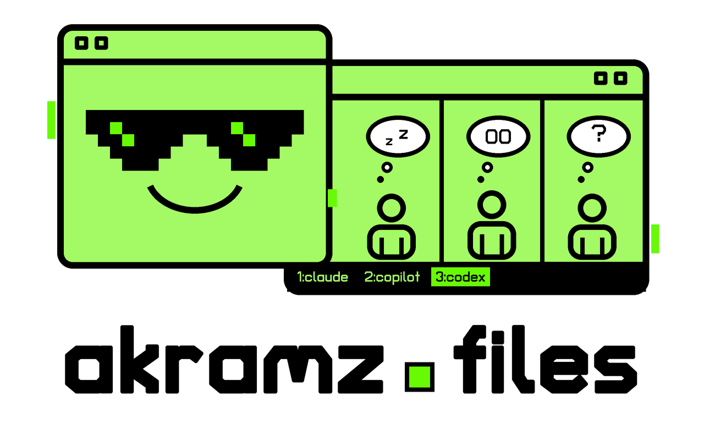

# `dotfiles`

I use this repo to keep my macOS and Linux setups consistent and easy to move
between machines. It manages my OS and app settings and installs the software
I use for personal projects and work.

A big part of the setup is working with coding agents: instructions, shared
skills, and settings for Claude Code, Copilot CLI, and Codex, plus tmux session
management across these CLIs.

Try the whole setup, take just the parts you need, or fork it and make it your own.

<p align="center">
  
</p>

## What a day looks like

- **ctrl+space, from anywhere.** A terminal drops down over whatever you are
  doing, using [Ghostty's quick terminal](config/ghostty/config).
  opt+shift+1..9 splits it into that many even panes, dropping idle shells
  first. ([`ghostty_panes.py`](home/bin/ghostty_panes.py))
- **`tp` shows every agent at a glance.** One list of tmux sessions, grouped by
  project, each tagged *active*, *waiting* (it needs you), or *idle* (done).
  Type to filter, Enter to jump in. Enter on a project lets you tick several
  sessions and opens them across the Ghostty splits, adding splits as needed.
  ([`tp_tui.py`](config/tp/tp_tui.py))
- **Agents survive a reboot.** Restart the Mac and every Claude and Copilot
  pane comes back in the same conversation, not a blank one.
  ([`agents.sh`](config/tmux-resurrect/agents.sh))
- **One skills folder for every agent.** Write a skill once; Claude, Copilot,
  and Codex all get it. ([`claude/skills`](claude/skills))
- **Keep your machine and the repo in sync.** Some apps replace a linked
  config with a regular file. `./install.sh doctor` detects this;
  `./install.sh pull` copies the changes back into the repo.

A few useful skills:

| Skill | What it does |
|---|---|
| [`explainy`](claude/skills/explainy/SKILL.md) | explains a repo, folder or diff to a total beginner: big pictures, few words |
| [`researcher`](claude/skills/researcher/SKILL.md) | hands a scoped research project to an agent that runs it end to end and leaves a paper draft |
| [`hunk`](claude/skills/hunk/SKILL.md) | opens a live diff pane beside the agent |
| [`gog`](claude/skills/gog/SKILL.md) | lets agents read your Gmail, Calendar and Drive |

## Take just one piece

You don't need the whole setup.

**`tp`** (tmux, zsh, Python 3, no packages): copy
[`config/tp/tp_tui.py`](config/tp/tp_tui.py) to `~/.config/tp/` and the `tp`,
`_tp_new` and `_tp_new_copilot` functions from [`home/.zshrc`](home/.zshrc) into your
`~/.zshrc`. The state tags read Claude Code's pane text; tune `WORKING_RE` and
`WAITING_RE` for other agents.

**Agents that resume after a reboot**: install
[TPM](https://github.com/tmux-plugins/tpm),
[tmux-resurrect](https://github.com/tmux-plugins/tmux-resurrect), and
[tmux-continuum](https://github.com/tmux-plugins/tmux-continuum), copy
[`agents.sh`](config/tmux-resurrect/agents.sh) into resurrect's
`save_command_strategies/`, then add:

```tmux
set -g @resurrect-save-command-strategy 'agents'
set -g @resurrect-processes 'claude copilot'
set -g @continuum-restore 'on'
```

**The ctrl+space terminal**: copy the quick-terminal block of
[`config/ghostty/config`](config/ghostty/config) into your Ghostty config and
give Ghostty Accessibility access. If the shortcut stops working, run
[`poke_ghostty.sh`](home/bin/poke_ghostty.sh).

## Install it all

> [!WARNING]
> Claude runs in auto mode and Copilot without permission prompts. Read [Safety defaults](#safety-defaults)
> before you install.

```sh
xcode-select --install                    # Mac only; wait for it to finish
git clone https://github.com/Akramz/dotfiles.git ~/dotfiles
cd ~/dotfiles && ./install.sh
```

The first run creates `personal/`, a folder Git ignores, for your Git name and
email, a short profile the agents read, and your own aliases, apps, scripts,
and private skills. Fill in `personal/gitconfig` and `personal/profile.md`,
then run `./install.sh` again. [More on
`personal/`](personal.example/README.md).

Then follow [MANUAL.md](MANUAL.md) for sign-ins and settings that need manual
setup. Plan on about 45 minutes for the install and an hour for the manual steps.

- **Work machine?** `./install.sh --with-work` adds [`work/`](work): the
  Microsoft apps, the `workiq` skill and notes for a managed Mac. The machine
  remembers this choice for future installs.
- **Linux?** Run [`linux/setup.sh`](linux/setup.sh) instead (Debian/Ubuntu,
  passwordless sudo). It installs the prerequisites, then `install.sh`.
- **Day to day:** `./install.sh doctor` checks your setup, `./install.sh pull`
  copies changed configs back into the repo, and `./install.sh` syncs your
  machine with the repo. Every stage is safe to rerun, and anything replaced
  is backed up to `~/.dotfiles-backup/` first.
- `install.sh` asks before it changes macOS settings. `DOTFILES_YES=1` says
  yes for you.

## Safety defaults

These settings fit my workflow on my own machine. Review and adjust them
before using this setup.

| Where | What it does |
|---|---|
| `cld` in [`home/.zshrc`](home/.zshrc) | `claude --permission-mode auto`: a classifier approves routine actions; risky ones still ask. Dash args pass through: `cld test --chrome` gives the session browser tools. `cld test --remote vm[:dir]` runs it in tmux on an ssh host; it survives disconnects, and rerunning reattaches |
| `pc`, and Enter in `tp` | `copilot --autopilot --yolo` |
| [`claude/settings.json`](claude/settings.json) | auto mode, `git push` allowed |
| [`copilot/settings.json`](copilot/settings.json) | `allow-all` permissions |
| [`vscode/settings.json`](vscode/settings.json) | agent tools auto-approved; every commit pushes; untrusted files open without asking |
| [`claude/init-submodules.sh`](claude/init-submodules.sh) | checks out submodules in every repo Claude opens, untrusted clones included |
| [MANUAL.md](MANUAL.md) | gives Ghostty and VS Code Full Disk Access |

## What's where

| Path | What it is |
|---|---|
| [`install.sh`](install.sh) | one script: install, `doctor`, `pull` |
| [`home/`](home) | zsh, tmux, and Git configs, plus small scripts for `~/bin` |
| [`config/`](config) | `tp`, the resurrect strategy, Ghostty |
| [`claude/`](claude) | agent instructions, settings, and skills (shared with Copilot and Codex) |
| [`copilot/`](copilot), [`vscode/`](vscode) | their settings |
| `Brewfile.general`, `Brewfile.linux` | apps and tools for macOS, with a smaller set for Linux |
| [`environments/base.yml`](environments/base.yml) | the base Python environment (macOS) |
| [`personal.example/`](personal.example) | the template for your gitignored `personal/` |
| [`work/`](work) | installed only with `--with-work` |

To add a dotfile, put it in the repo and add one line to `LINKS_ALL` in
`install.sh`.

## Status

My personal setup, shared as-is. Issues are welcome, but I can't promise support.
Licensed under the MIT License; see [LICENSE](LICENSE).
